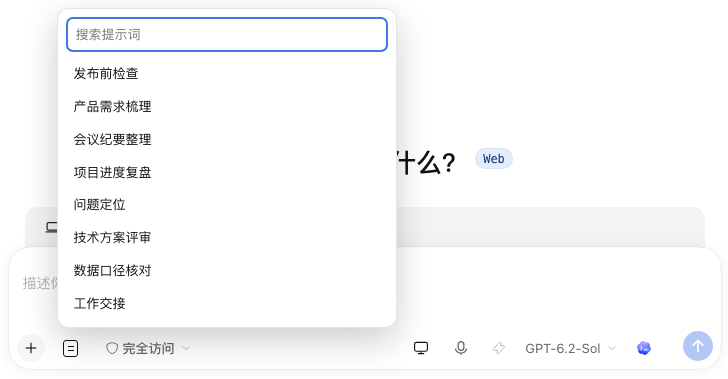
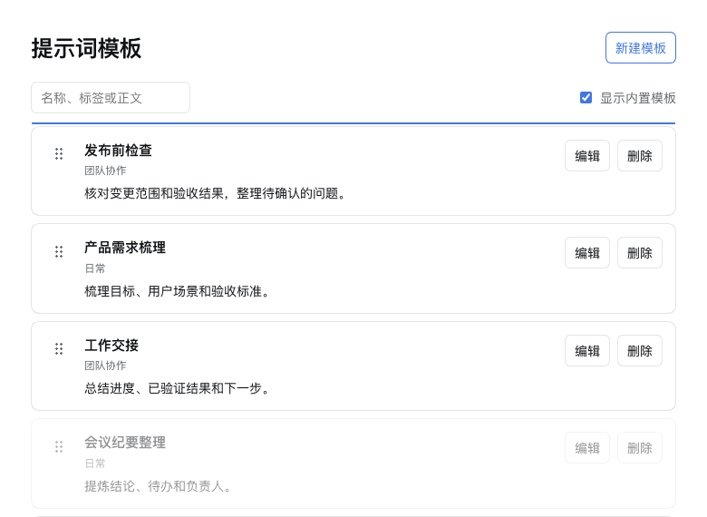

# 提示词模板 · Prompt Templates

在 CodexHost 的聊天输入框左下角搜索并插入常用提示词，适用于 Codex Desktop 和 CH Web。



## 安装

需要支持 `manifestVersion: 2`、`page`、`widget` 和 `backend` 的 CodexHost。模板管理、拖拽排序和草稿插入已在 CodexHost `0.26.1` 的 Desktop 和 CH Web 环境验证。

从 [GitHub Release](https://github.com/zxd-666/codexhost-prompt-templates/releases/latest) 下载 `prompt-templates-1.1.1.zip`。

| 客户端 | 导入并启用 | 打开独立页面 |
| --- | --- | --- |
| Codex Desktop | 设置 → 插件 → 导入插件 → 本地 `.zip` → 安装并启用 | 插件卡片的「打开页面」，或设置左侧「插件页面 → 提示词模板」 |
| CH Web | 左侧「插件」→ 插件中心 → 导入插件 → 本地 `.zip` → 上传 ZIP → 安装并启用 | 插件工作区顶部切页栏的「提示词模板」，或插件卡片的「打开页面」 |

安装后回到对话输入框，点击「添加文件」旁边的模板图标。Web 插件中心需要通过启用访问认证的 Host 打开。

如果已通过本地 ZIP 安装旧版，在插件中心卸载旧版后导入新版并启用。codexhost `0.26.1` 的标准卸载会保留模板数据。

## 使用

- **搜索和插入**。结果只显示模板名称，支持按名称、标签或正文搜索。点选模板或按 `Enter` 插入草稿，按 `Esc` 关闭。已有文字会保留，发送使用宿主原有操作。
- **管理和排序**。新增、编辑和删除自定义模板，也可隐藏内置模板。拖动模板左侧的六点手柄后松手即可保存顺序，聚焦手柄时也可用上下方向键移动。管理页和输入框弹窗使用同一顺序。
- **双端共享**。连接同一个 CodexHost Host 的 Desktop 和 Web 共享模板。模板保存在该 Host 的插件数据中，共享后端通过 Host 的存储接口读写模板和排序。



## 打包

在包含 `manifest.json` 的源码目录运行以下命令。修改清单中的版本号后，使用对应版本的新 ZIP 文件名。

```sh
version=$(node -p 'require("./manifest.json").version')
zip -rX "../prompt-templates-${version}.zip" manifest.json page widget shared assets backend
unzip -t "../prompt-templates-${version}.zip"
```

`manifest.json` 位于 ZIP 根。`page/index.mjs` 与 `widget/index.mjs` 分别导出 `mount(root, api)`，各自跨端复用，通过相对导入共享模板逻辑。挂件根据两端原生输入框的 DOM 标记定位，在可编辑的聊天输入框左侧工具组中占位。

## 发布到 GitHub

1. 创建公开仓库，将本目录中的源码、素材、README 和根级 `manifest.json` 提交到默认分支。
2. 在 GitHub 的 **Releases → Draft a new release** 创建与清单版本一致的标签。
3. 上传一个插件 ZIP，并将 `icon.png`、`composer.png`、`library.png` 作为独立附件上传。用户可以下载 ZIP 本地导入，也可以从「导入插件 → GitHub」粘贴公开仓库地址。

功能参考 [dsh-prompt](https://github.com/FeatherHunter/dsh-prompt)。扩展契约见 [codexhost 官方开发规范](https://github.com/BytePioneer-AI/codex-host/blob/main/.agents/skills/codexhost-add-desktop-extension/SKILL.md)。
